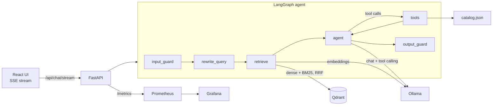

# Liora Assistant

An **agentic retrieval-augmented generation (RAG) assistant** for Srijana of Liora By Srijana, a brand of hand-poured scented candles. It helps people find a piece, check prices, add up an order, look after their candles and order on WhatsApp. Answers are cited to the 2026 product catalogue, guardrails run on the input and the output, and each answer shows the path it took through the agent.

It uses the same agentic workflow and stack as the GT-M Store Assistant. **The whole stack is free and open source, with no API keys or paid cloud services.**

## The agent



| Tool | What it does |
|---|---|
| `search_knowledge_base` | Searches products, care, ordering and gifting notes again with a new query |
| `find_products` | Browses by keyword, category and budget |
| `get_product_details` | Gives the exact price, code and description by name or `LS0xx` code, including what's in a hamper |
| `calculate_order_total` | Adds up an order before shipping and prepares the codes to send on WhatsApp |

Prices always come from `backend/data/catalog.json` through a tool, so a model can't misremember one. The assistant can't place or track orders, because Liora takes those on WhatsApp.

## Run it

### Demo with no model (Windows)

```bash
./run-demo.ps1
```

Then open http://localhost:8000. This needs Python 3.12 but not Node, because it serves the built UI in `frontend/dist`. Demo mode uses a simple extractive stand-in for the LLM, so answers are stitched from catalogue sentences and read less naturally than a real model's.

### With a real open-source LLM

```bash
ollama pull llama3.1:8b
ollama pull nomic-embed-text
cp .env.example .env
make install
make dev
```

Then open http://localhost:5173. Changing the UI needs Node 20 or later; run `npm run build` in `frontend` to refresh `dist`.

### Everything in Docker

```bash
make docker-up
```

| Service | URL |
|---|---|
| App | http://localhost:3000 |
| API docs | http://localhost:8000/docs |
| Grafana dashboard | http://localhost:3001 |
| Prometheus | http://localhost:9090 |

## Updating the content

- **Prices or products:** edit `backend/data/catalog.json` and `backend/data/knowledge_base/product-catalog.md` together (a test checks they agree). Photos live in `frontend/public/products/`. Six shop-only products have `"code": null` and are ordered by name; give them real codes in both files when Liora assigns them.
- **Policies and notes:** edit the Markdown in `backend/data/knowledge_base/`, or upload files in the Knowledge base tab.
- **After editing those files on a real model:** the search index is kept on disk and only built when empty, so rebuild it with `POST /api/documents/reindex` (for example from http://localhost:8000/docs).

**Before going public:** the document upload, delete and reindex endpoints have no login. Remove or protect them, and hide the Knowledge base tab, before customers can reach the app.

## Evaluation and release gate

```bash
make eval          # offline, deterministic — what CI runs
make eval-judge    # your Ollama model, scored by an LLM judge
```

The run writes `backend/reports/eval_report.md` and exits non-zero if any metric is below `data/eval/thresholds.yaml`. The 30-example golden set covers retrieval, tool use and safety, including questions the catalogue can't answer.

## API

| Method | Path | Purpose |
|---|---|---|
| POST | `/api/chat` | Answer, sources, flags, groundedness and full trace |
| POST | `/api/chat/stream` | Same, as SSE: `step`, `token`, `final` |
| POST | `/api/sk/chat` | Semantic Kernel orchestrator |
| POST | `/api/search` | Inspect retrieval (`hybrid`, `dense` or `sparse`) |
| GET / POST / DELETE | `/api/documents` | List, upload (md, txt, pdf) or remove documents |
| POST | `/api/documents/reindex` | Rebuild the index from `data/knowledge_base` |
| GET | `/api/health`, `/metrics` | Health and Prometheus metrics |

## License

Code: MIT. Product names, photos, logo and catalogue content belong to Liora By Srijana.
